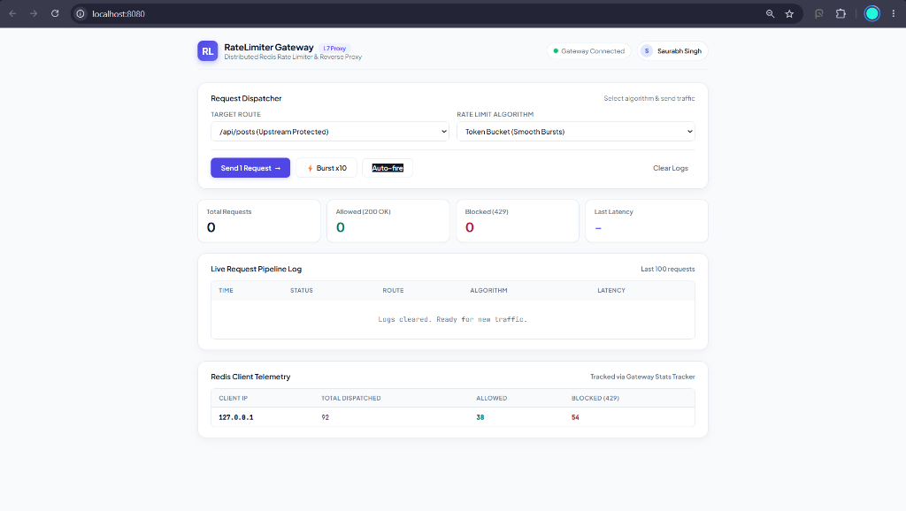
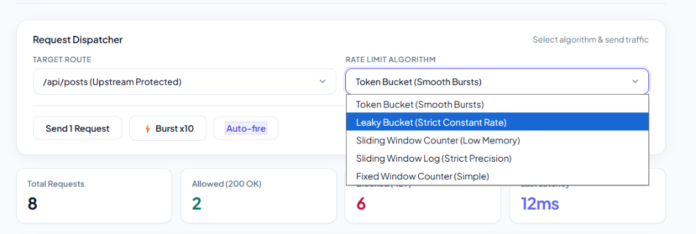

# Rate Limiter Gateway

A lightweight **API Gateway** built with Express that sits in front of the backend services and enforces **rate limiting** using Redis. It supports five different rate limiting algorithms, request logging, and per client stats tracking with a minimal web console to monitor traffic in real time.

**Live Demo:** [https://rate-limiter-gateway-3t5x.onrender.com](https://rate-limiter-gateway-3t5x.onrender.com)

---

## Features

- **5 Rate Limiting Algorithms** — choose per request via query param
  - Fixed Window Counter
  - Sliding Window Log
  - Sliding Window Counter
  - Token Bucket
  - Leaky Bucket
  
- **Reverse Proxy** — forwards `/api/*` requests to the backend service
- **Stats Tracking** — tracks total/allowed/blocked requests per client (by IP)
- **Request Logging** — structured logging via Winston (console + file logs, separate log for blocked requests)
- **Gateway Console UI** — simple HTML dashboard to test and visualize rate limiting behavior
- **Redis-backed** — all algorithms use atomic Redis Lua scripts for consistency under concurrent load

---

## Tech Stack

- **Node.js** + **Express 5**
- **Redis** (via `ioredis`) — for distributed rate limit state
- **http-proxy-middleware** — reverse proxy to backend
- **Winston** — logging
- **CORS**

---

## Project Structure

```
rate-limiter-gateway/
├── server.js                  # Main gateway server (port 8080)
├── mockServer.js              # Sample backend service (port 3000)
├── UI/
│   └── index.html             # Gateway Console frontend
├── src/
│   ├── algorithms/
│   │   ├── fixedWindowCounter.js
│   │   ├── slidingWindowLog.js
│   │   ├── slidingWindowCounter.js
│   │   ├── tokenBucket.js
│   │   └── leakyBucket.js
│   ├── config/
│   │   ├── rateLimitConfig.js # Algorithm & limit configuration
│   │   └── redisClient.js     # Redis connection
│   └── middleware/
│       ├── rateLimiter.js     # Applies the selected algorithm
│       ├── requestLogger.js   # Logs every request
│       ├── statsTracker.js    # Tracks per-client stats
│       └── logger.js          # Winston logger setup
```

---

## Getting Started

### Prerequisites

- Node.js (v18+ recommended)
- Redis server running locally (`redis-server` or Docker)

### Installation

```bash
git clone https://github.com/SaurabhSinghR45/rate-limiter-gateway.git
cd rate-limiter-gateway
npm install
```

### Running the project

```bash
# 1. Start Redis (if not already running)
# Local:
redis-server

# Or with Docker:
docker run -d --name redis -p 6379:6379 redis:alpine

# 2. Start the gateway (automatically starts the mock backend on port 3000)
npm start
# runs on http://localhost:8080
```

All requests to `http://localhost:8080/api/*` will pass through the rate limiter before being proxied to the backend.

---

## Usage

### Making a request through the gateway

```bash
curl "http://localhost:8080/api/users?algo=fixedWindow"
curl "http://localhost:8080/api/posts?algo=tokenBucket"
```

The `algo` query parameter selects which rate limiting strategy to apply:

| Value             | Algorithm               |
|-------------------|--------------------------|
| `fixedWindow`     | Fixed Window Counter     |
| `slidingLog`      | Sliding Window Log       |
| `slidingCounter`  | Sliding Window Counter   |
| `tokenBucket`     | Token Bucket             |
| `leakyBucket`     | Leaky Bucket             |

If no `algo` param is passed, the request is evaluated against the default configured algorithm.

### Health check

```bash
GET http://localhost:8080/health
```

### View stats

```bash
GET http://localhost:8080/stats
```

Returns per-client request counts:

```json
{
  "127.0.0.1": { "total": 12, "allowed": 9, "blocked": 3 }
}
```

---

## Configuration

Rate limit values can be adjusted in `src/config/rateLimitConfig.js`:

```js
export const limit = 10          // requests allowed per window
export const capacity = 5        // bucket capacity (token/leaky bucket)
export const windowSize = 10     // window size in seconds
export const refillRate = 1      // tokens added per second
```

---

## Gateway Console (Frontend)

A clean Web UI (`UI/index.html`) is served directly by the gateway to test and visualize allowed vs blocked requests in real time.

- **Live URL:** [https://rate-limiter-gateway-3t5x.onrender.com](https://rate-limiter-gateway-3t5x.onrender.com)
- **Local URL:** `http://localhost:8080`

**Dashboard Overview:**


**Live Rate Limiting Test:**


---

## Logging

Logs are written using Winston to:
- `logs/requests.log` — all requests
- `logs/blocked.log` — only rate-limited (429) requests

---

## Deployment

### Live Service
The project is deployed on Render:
[https://rate-limiter-gateway-3t5x.onrender.com](https://rate-limiter-gateway-3t5x.onrender.com)

### Docker Compose

```bash
docker compose up -d
```

### Render Deployment

1. Create a free Redis instance on [Upstash](https://upstash.com) and copy the `rediss://...` connection string.
2. In [Render](https://dashboard.render.com), create a new **Web Service** connected to your repository.
3. Set the Environment Variable:
   - `REDIS_URL` = `your_upstash_redis_url`
4. Deploy.

---

## Author

Saurabh Singh
- GitHub: [SaurabhSinghR45](https://github.com/SaurabhSinghR45)
